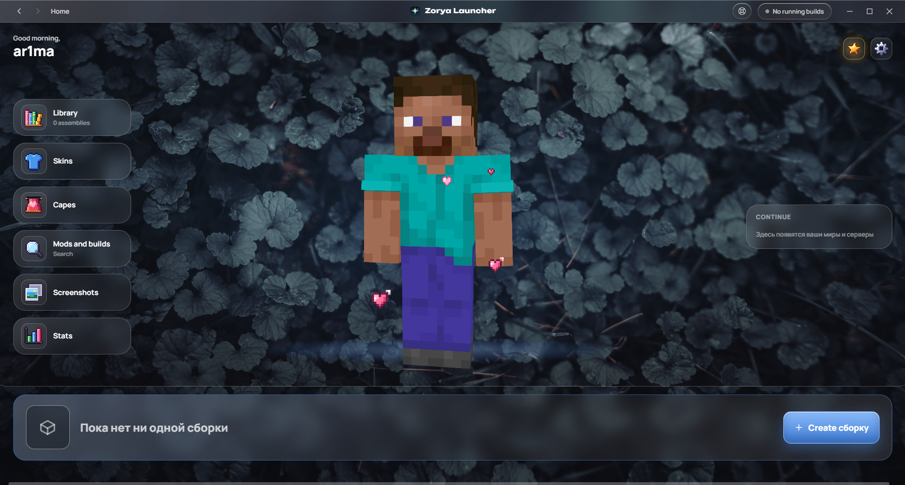

# Zorya Launcher

A Windows launcher for Minecraft focused on **Horizon (Minecraft Java 26.3 rewritten in Rust)**: instances, mods, resource packs and direct local game start.



Download the installer from the [releases page](https://github.com/romamakovij7-cmyk/zorya-launcher/releases/latest) or from [zorya-launcher.com/launcher](https://zorya-launcher.com/launcher).

Zorya Launcher is an unofficial, open-source (MIT) project. It is not affiliated with Mojang Studios or Microsoft. Minecraft is a trademark of Mojang Studios.

## Install

1. Download `Zorya-Launcher-Setup-<version>.exe` from the releases page.
2. Run it and follow the installer. Windows may show a SmartScreen warning because the installer is not code-signed with a paid certificate — choose **More info → Run anyway**.
3. The launcher updates itself after installation.

If your antivirus flags the installer, add the launcher folder and installer to its exceptions, or build from source yourself. The installer, game files and Java are downloaded over the internet, which is normal for any Minecraft launcher.

## Features

- Accounts: Microsoft and offline (up to 5 offline accounts; every offline account can use skins, capes, hearts and nickname colours).
- Instances: create, import, update; mods, resource packs and shader packs.
- Horizon 26.3 builds start directly from locally installed files — no GitHub download is needed to play.
- Native mods: build with the official `horizon-launcher` for the selected instance.
- Themes: Liquid, Midnight and Light, accents, custom background image, animation rate.
- Game log viewer, instance folders, keybinds and per-instance settings.

## Build from source

Requirements: Windows and Node.js 24+ (Linux and macOS are not supported).

```powershell
npm ci
npm run dev              # Vite + Electron with hot reload (slower)
npm run build:renderer   # build the UI
npm start                # run the built version
npm run dist             # build the installer in release/
```

The installer is unsigned, so SmartScreen may warn on first run.

## Network

No analytics, ads or trackers. The launcher contacts these services only when used:

- Mojang / Microsoft — version manifests, libraries, assets, Microsoft sign-in (password never reaches the launcher).
- Fabric, Quilt, Forge, NeoForge — version lists and installers (BMCLAPI mirror fallback).
- Modrinth, CurseForge (optional API key), Technic — mod and pack catalogs.
- GitHub / zorya-launcher.com — Horizon builds, launcher release and updates.
- Adoptium / Microsoft — Java for Horizon when needed.
- Google Translate — only if you use description translation.
- DNS-over-HTTPS (Cloudflare / Google) is automatic.

Microsoft tokens are encrypted with Windows DPAPI. Settings are stored in `%APPDATA%\ZoryaLauncher`.

## Bundled files

| File | Size | Purpose |
| --- | --- | --- |
| `build/agent/zorya-agent.jar` | 2 KB | Java agent entry point (`premain`) |
| `build/agent/zorya-core.jar` | 180 KB | Agent core, includes ASM (BSD) |
| `build/tools/rcedit-x64.exe` | 1.3 MB | electron/rcedit (MIT), sets icon/version in the installer |

Both jars are built from `zorya-agent/src` with `npm run build:agent` (JDK 17+, targeting Java 8). They are committed so the installer can be built without a JDK.

## Security

Please do not open a public issue for vulnerabilities. Use **Security → Report a vulnerability** in this repository; see `SECURITY.md`.

## Custom server and keys

The site address and the public update/license keys are compiled into `electron/updateConfig.js`, `electron/updatePublicKey.js` and `electron/licensePublicKey.js`. Replace them for your own fork. Private keys are not in the repository.

## Third-party components

Dependencies and their licences are listed in `package.json` (mostly MIT; Manrope and Unbounded under SIL OFL; DOMPurify under MPL-2.0 or Apache-2.0). Horizon is not included — the launcher downloads official builds. Default skins (Steve, Alex, etc.) belong to Mojang Studios.

## License

MIT. See `LICENSE`.
